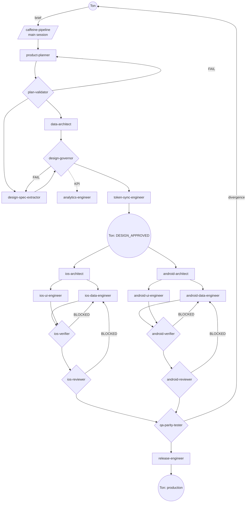

# Caffeine — Agentic Workflow (iOS + Android, native)

Adapted on 21 Nov 2026 from the reference project `myproject/caffeine-project` (31 agents). Changes from the reference:
- Orchestrators are **skills run in the main session** (`/caffeine-pipeline`, `/ios-pipeline`, `/android-pipeline`), because Claude Code subagents cannot start other subagents. The reference `*-orchestrator` agents had no way to call their workers.
- The six-agent UX lane is replaced by a **design handoff lane** (`design-spec-extractor`, `design-governor`, `token-sync-engineer`), because the v5.1 Figma design already exists. New design work still uses the `designer` skill loop with Ton.
- PM + four BA agents are merged into `product-planner` + `plan-validator`.
- Design source is this repo's Figma file and `Caffeine / Night` tokens (SF Pro), not the reference `MASTER.md` / Kanit.
- Retry budget is **3 attempts per gate** (matches the design loop in CLAUDE.md). Minimum OS: **iOS 18**, **Android API 28**.

## Modes
- **Solo (default)**: `solo-planner` → `solo-builder`, one platform per pass, no status files.
- **Team**: `/caffeine-pipeline <feature> <ios|android|both>`. Switch when a second person joins, features ship faster than Ton can review, or an iOS/Android difference reaches a user.

## Flow

## How agents connect
1. **Main session is the conductor.** Only the pipeline skills start agents (Agent tool). Agents never call each other.
2. **Files are the wires.** Each agent reads the previous stage's file and writes its own:
   brief → `docs/plan/<f>-plan.md` → `docs/data-model/<f>-model.md` + `<f>-cases.md` and `docs/design/<f>-spec.md` + screenshots → `docs/design/<f>-governance.md` → token files in both apps → `docs/pipeline/
-arch-<f>.md` → code + tests → `docs/pipeline/
-status.md` → `docs/review/<f>-
-review.md` → `docs/pipeline/
-feedback-<f>.md` → `docs/review/<f>-qa.md` → `docs/release/<f>-release.md`.
3. **Status files are the clock.** `docs/status.md` (main), `docs/pipeline/ios-status.md`, `docs/pipeline/android-status.md` (lanes). Each agent checks the status it waits for and sets the next one.
4. **Gates loop back** with a Feedback list; fixes re-run every gate forward; 3 failures of one gate stop the run for Ton.
5. **Parallelism**: data-architect ∥ design-spec-extractor; iOS lane ∥ Android lane; inside a lane data engineer ∥ UI engineer (separate folder ownership set by the architect).
6. **Human gates**: design approval before code; production release.
7. **Memory**: `docs/lessons.md`, read first, appended at the moment of failure.

## Agents
| Agent | Model | Stage | Responsibility | Gate |
|---|---|---|---|---|
| product-planner | opus | 1 | Brief → need, scope, flow, atomic tasks, Given/When/Then ACs, screen map | — |
| plan-validator | sonnet | 2 | Developer-readiness of every task and AC | fields, format, branch coverage |
| data-architect | opus | 3 | Logical model + SwiftData + Room mappings, repositories, migrations, shared test cases | — |
| design-spec-extractor | sonnet | 3 | Figma v5.1 frames (Dark + Light) → spec, screenshots, ids, gaps | own checklist |
| design-governor | opus | 4 | Accessibility, contrast both modes, hit targets, font scaling, privacy | labels, contrast ratios |
| analytics-engineer | sonnet | 4 (optional) | KPI → event plan, no PII/money | — |
| token-sync-engineer | sonnet | 5 | Figma variables/styles → xcassets + Swift, Kotlin theme | token diff = 0 |
| ios-architect / android-architect | opus | lane 1 | MVI contracts, navigation, components, file ownership | — |
| ios-data-engineer / android-data-engineer | sonnet | lane 2a | SwiftData / Room models, repositories, migrations, TDD | own tests |
| ios-ui-engineer / android-ui-engineer | sonnet | lane 2b | Screens, Store/ViewModel, components, previews, ids, TDD | own tests |
| ios-verifier / android-verifier | sonnet | lane 3 | Build, tests, AC coverage, lint, simulator/emulator | exit codes |
| ios-reviewer / android-reviewer | opus | lane 4 | Read-only review, greps, security, fidelity | greps + severity |
| qa-parity-tester | sonnet | 7 | Same Appium test on both apps | pass on both |
| release-engineer | sonnet | 8 | fastlane test + beta, release notes | lane exit codes |
| solo-planner / solo-builder | sonnet | Solo | Plan and build one platform end to end | own tests |

## Skills
Pipeline: `caffeine-pipeline`, `ios-pipeline`, `android-pipeline`, `loop-engineering`.
Shared: `caffeine-domain`, `tdd-workflow`, `figma-handoff`, `design-tokens`, `appium-parity`, `fastlane-deployment`.
iOS: `swift-style`, `mvi-ios`, `swiftdata-patterns`, plus `skills/ios-swiftui-design`. Android: `kotlin-style`, `mvi-android`, `room-patterns`, `compose-craft`.
Design (existing, unchanged): `skills/designer`, `skills/ios-swiftui-design`.

## Open decisions for Ton
- Android font (SF Pro can't ship on Android): system Roboto by default.
- Android package `com.tonapps.caffeine`, iOS bundle id `com.tonapps.caffeine` (placeholders until signing is set up).
