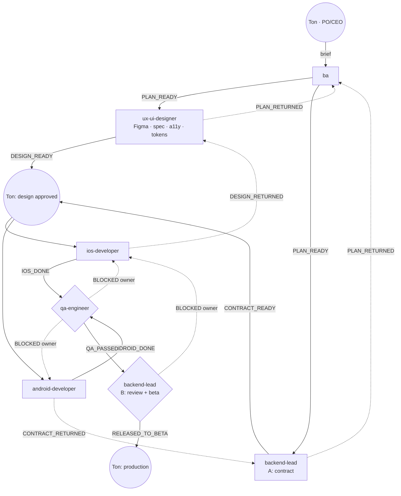

# Caffeine — Agentic Team (role-based, 21 Nov 2026)

Refactored on 21 Nov 2026 from 21 stage agents into **6 role agents + Ton**, one agent per responsibility. The old agents and the `ios-pipeline` / `android-pipeline` skills are kept in `_backup/2026-11-21-before-role-team/`.

## The team
| Role | Agent | One responsibility | Owns (only it writes here) | Model |
|---|---|---|---|---|
| Product Owner & CEO | **Ton** | Why and when: brief, design approval, production release, open questions | `docs/briefs/` | human |
| BA | `ba` | The plan: need, scope, flow, tasks, Given/When/Then ACs, screen map, analytics events | `docs/plan/`, `docs/analytics/` | opus |
| UX/UI Designer | `ux-ui-designer` | The design: **Figma (only writer)**, spec, accessibility check, design tokens | Figma file, `docs/design/`, generated token files, `scripts/tokens/` | opus |
| Backend Engineer, Team Lead | `backend-lead` | Technical integrity: contract before build; review + beta after QA; `backend/` in Phase 2 | `docs/data-model/`, `docs/review/<f>-review.md`, `docs/release/`, `backend/` | opus |
| iOS Developer | `ios-developer` | The iOS app, data to screens, test-first | `ios-app/` (except token files and `Tests/QA/`), `docs/pipeline/ios-status.md` | sonnet |
| Android Developer | `android-developer` | The Android app, data to screens, test-first | `android-app/` (except token files and `.../qa/` tests), `docs/pipeline/android-status.md` | sonnet |
| QA Engineer | `qa-engineer` | Independent verification of both apps | `qa-automation/`, QA test folders, `docs/review/<f>-qa.*` | sonnet |

Conductor: the `/caffeine-pipeline` skill in the main session (agents can't start agents). It starts agents and routes Feedback; it does no agent's work and never edits Figma.

## What was merged and why
| Before (21) | After | Why |
|---|---|---|
| product-planner, plan-validator, solo-planner, analytics-engineer | `ba` | One plan, one owner; validation is the BA's own Verify step |
| design-spec-extractor, design-governor, token-sync-engineer (+ designer skill in the main session) | `ux-ui-designer` | One owner for Figma and everything that leaves it; only it can write Figma |
| data-architect, ios-reviewer, android-reviewer, release-engineer | `backend-lead` | The lead defines the contract and accepts the code against it |
| ios-architect, ios-data-engineer, ios-ui-engineer, solo-builder | `ios-developer` | 1 handoff instead of 4; no file-ownership conflicts inside a platform |
| android-architect, android-data-engineer, android-ui-engineer | `android-developer` | same |
| ios-verifier, android-verifier, qa-parity-tester | `qa-engineer` | One independent gate for both platforms |

## Flow



Solid = handoff, dotted = Feedback back to the owner (full routing table in `.claude/skills/caffeine-pipeline/SKILL.md`).

## Every agent runs your loop
```
Start -> Set Goal -> Reason -> Verify -> Pass? --YES--> set status (hand off)
                       ^                  |
                       |                  NO
                       +----- Fix <--- Feedback
```
- **Set Goal**: numbered PASS/FAIL criteria at the top of the agent's output file.
- **Verify**: mechanical checks first (checklists, contrast, token diff, build/test/lint exit codes, greps), judgment second.
- **Max 3 passes** inside an agent, and **3 attempts per gate** across agents, then Ton decides.
- **Builder ≠ verifier**: each agent checks itself, then the next gate re-checks (developers → QA → lead).
- Lessons go to `docs/lessons.md` at the moment of failure; every agent reads it first.

## Handoff wires (files)
brief → `docs/plan/<f>-plan.md` → `docs/design/<f>-spec.md` + `img/` + `<f>-a11y.md` + tokens ∥ `docs/data-model/<f>-model.md` + `<f>-cases.md` → **GATE 1** → code + `docs/pipeline/<p>-status.md` → `docs/review/<f>-qa.md` → `docs/review/<f>-review.md` → `docs/release/<f>-release.md` → **GATE 2**.

Status clock: `docs/status.md` (main), `docs/pipeline/{ios,android}-status.md` (lanes).

## Figma rule
Only `ux-ui-designer` has Figma tools, including write (`use_figma`, `upload_assets`). Every other agent has none, so the rule is enforced by the agents' tool lists, not by trust. The main session follows the same rule through the conductor. File: https://www.figma.com/design/jVIND6Rm2KzxmEhO6w2b00/Caffeine?node-id=482-29722 (Feature Journeys `482:29722`; builds use v5.1 `446:10036`; navigation from App Prototype `540:21852`).

## Modes
- **Team**: `/caffeine-pipeline <feature> <ios|android|both>`.
- **Solo**: `/caffeine-pipeline <feature> ios --solo` → `ba` → (`ux-ui-designer` only for design gaps) → one developer → Ton. A new entity or migration ends solo mode.

## Open decisions for Ton
- Android font (SF Pro can't ship on Android): system Roboto by default.
- Bundle id / package `com.tonapps.caffeine` are placeholders until signing is set up.
